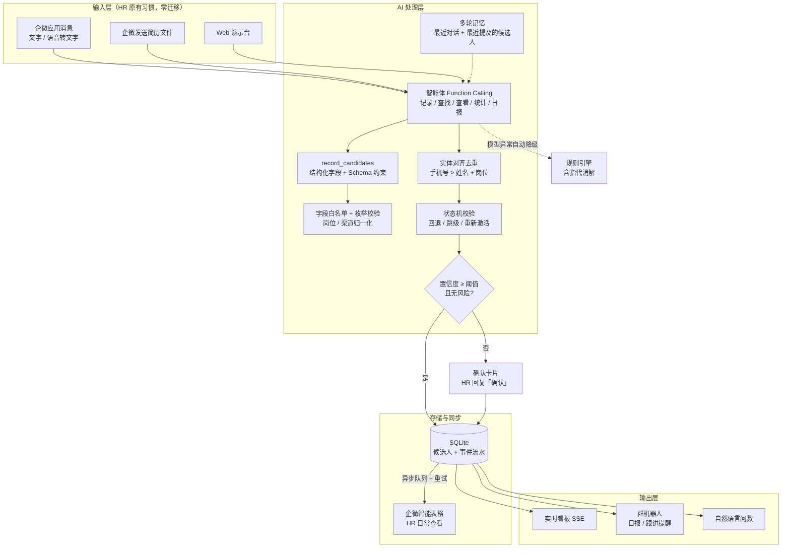

# 招聘助手 · AI 招聘数据自动化

[](https://github.com/soyorin33/recruit-ai-assistant/actions/workflows/ci.yml)

> HR 在企业微信里**像平时一样说一句话**，AI 自动把它变成结构化招聘数据，实时同步到智能表格和看板，并每天自动推送日报和跟进提醒。

**痛点**：HR 每天要在企业微信、群聊和腾讯文档之间来回翻找、手工录入招聘进展，效率低、容易漏、更新不及时。
**思路**：不让 HR 换工具、不加新流程。数据从 HR 本来就在用的企微对话里采集，AI 负责「听懂」，代码负责「算对」，智能表格和群机器人负责「同步」与「提醒」。

| 能力 | 怎么实现 | 对应题目要求 |
|---|---|---|
| 🤖 多轮对话智能体 | 大模型 Function Calling 自主调用 5 个工具（记录 / 查找 / 查看 / 统计 / 日报）；理解「把他改到周五」这类指代，信息不全时会反问 | 智能化 |
| 💬 一句话记录 | 口语消息自动变成结构化字段（支持一句话包含多人、相对时间换算） | 自动化记录 |
| 👥 群里 @ 助手 | 接入企微「智能机器人」：在招聘群里 @招聘助手 就能记录或查询，用流式消息实时显示智能体每一步的进度 | 企业微信群 |
| 📄 简历自动建档 + 岗位匹配 | PDF / TXT 简历自动建档，并对照岗位要求打分（命中项 / 缺失项 / 风险 / 3 个建议面试问题） | 替代手工录入、智能化 |
| 🖼️ 截图识别 | 简历截图、招聘软件聊天截图交给视觉模型识别，补充进候选人档案 | 替代手工录入 |
| 🔁 实时同步 | 写入后异步同步到企微智能表格；网页看板通过 SSE 秒级刷新 | 实时同步更新 |
| 📊 数据可视化 | KPI、招聘漏斗、岗位分布、渠道效果、14 天趋势 | 数据可视化 |
| 🙋 自然语言问数 | 「本周各岗位进了几个复试？」：AI 理解问题，代码负责查数 | 智能化 |
| 📰 AI 日报 / 预警 | 每天定时推送到企微群：今日进展、漏斗、明日面试、超时与漏填反馈提醒、AI 洞察 | 解放人工 |
| 🛡️ 人在回路 + 交叉校验 | 置信度低、阶段回退、同名冲突，或规则引擎复核结果与大模型冲突时，先发确认卡片，HR 一键确认后才写入 | 可落地、可信 |

---

## 一、快速开始（1 分钟，无需任何账号）

```bash
python3 -m venv .venv && source .venv/bin/activate
pip install -r requirements.txt
uvicorn app.main:app --port 8000
```

打开 http://localhost:8000 。首次启动会自动生成近 3 周的演示数据。

> 不配置大模型 Key 时，系统自动使用**本地规则引擎**，所有功能都能完整演示。复制 `.env.example` 为 `.env` 并填入 `LLM_API_KEY`，即可切换到大模型（DeepSeek / 腾讯混元 / 通义千问等任意 OpenAI 兼容接口）。

其他常用命令：

```bash
python -m pytest -q                   # 93 项测试，含智能体、企微端到端、群 @ 机器人、截图识别、访问控制、数据一致性
python -m eval.run_eval --engine both # 抽取准确率评测：规则引擎 vs 大模型（需要 Key）
python -m eval.agent_scenarios        # 智能体多轮对话场景测试（需要 Key）
python -m scripts.doctor              # 接入自检：逐项检查模型 / 企微 / 表格 / 群机器人
python -m scripts.check_db            # 数据库一致性检查：枚举、时间顺序、重复、流水回放
```

## 二、演示脚本（建议按顺序点左下角的示例）

1. **新候选人建档**：`张三 Java后端 BOSS来的，一面过了，明天下午3点二面，面试官陈晨`
   → 自动建档：岗位归一为「后端开发」，渠道归一为「BOSS直聘」，阶段推到「复试」，面试时间换算成绝对时间。右侧看板和总表实时刷新，变更行会高亮。
2. **多轮对话**：依次点「多轮·改时间」「多轮·换面试官」「多轮·追问」
   → `把他的二面改到后天上午10点`、`他的面试官换成林峰`、`他现在什么情况？` 都能正确对应到张三。展开「AI 解析」可以看到「指代：他 → 张三」；大模型模式下还能看到智能体每一步调用了哪个工具。
3. **一句话更新多人**：`王芳二面挂了，算法基础薄弱；赵磊接了offer`
   → 识别出两位**已有**候选人并分别更新，不会重复建档；「算法基础薄弱」记为评价，不会被误识别成岗位。
4. **触发人工确认**：`张三一面挂了`
   → 状态机发现「复试 → 初试」属于阶段回退，于是弹出确认卡片，确认后才写入。
5. **问数**：`本周各岗位进了几个复试？`、`招聘漏斗怎么样？`、`赵磊怎么样了`
6. **简历 + 岗位匹配**：点「示例简历」，自动建档并给出匹配分、命中项和建议面试问题；在总表中点开候选人可以看到完整的匹配详情。点 📎 也可以上传截图（需要配置视觉模型）。
7. **日报**：点右上角「生成日报」，配置了群机器人时会同时推送到企微群。
8. 点总表中的任意候选人，可查看**变更时间线**，每条都能追溯到原始消息。

## 三、架构



### 关键设计（AI 应用能力的体现）

0. **多轮对话智能体**（`app/agent.py`）：基于大模型 Function Calling，由模型自己决定调用哪些工具、按什么顺序调用，例如「李雷什么情况？顺便看下本周各岗位进复试的人数」会依次调用查找 → 查看详情 → 统计查询。
   - **多轮记忆**：从消息表中还原每位 HR 最近 6 小时的对话和「最近提及的候选人」。不依赖内存，服务重启后也不会丢；不同 HR 之间的上下文互相隔离。
   - **写入护栏**：模型不能直接修改数据库，只能调用 `record_candidates`，而这个工具仍然会走「去重 → 状态机校验 → 置信度判断 → 人工确认」整条流程。即使模型判断错了，也只会生成一张待确认卡片，不会直接写坏数据。
   - **受控执行**：每轮最多调用 6 次工具；遇到未知工具或参数错误时，把错误信息返回给模型，由模型向 HR 解释；拿不准时直接反问。
   - **降级**：模型不可用时自动切换到规则引擎，规则引擎同样能处理「他 / 她 / 这个人」这类指代。
1. **AI 理解，代码计算**：大模型只负责「理解消息 / 理解问题 / 组织语言」，所有统计数字都由代码查询得出，从机制上杜绝模型编造数据（见 `app/nlq.py`）。
2. **结构化输出 + 防越界**：Prompt 中给出字段规范、枚举、口语映射规则（如「一面过了」表示进入复试）和 Few-shot 示例；输出经过白名单、枚举和时间格式校验，非法值直接丢弃（见 `app/extractor.py`）。
3. **人在回路**：以下情况不自动写入，而是转为确认卡片：置信度低于阈值、阶段回退或跳级、已淘汰后重新激活、同名但岗位不同。在企微里回复「确认」或「取消」即可处理（见 `app/pipeline.py`）。
4. **可追溯**：每次变更都记录事件流水（变更前后的值、操作人、原始消息、AI 引擎），出了问题能查清楚是谁、在什么时候、因为哪句话改的。
5. **高可用降级**：没有配置 Key、模型超时或返回异常时，自动降级到规则引擎，业务不中断，界面上也会提示已降级。
6. **模型无关**：使用 OpenAI 兼容协议，切换 DeepSeek、混元、通义只需改两个环境变量。
7. **企微工程细节**：回调消息使用 AES 加解密（自行实现 WXBizMsgCrypt）；先在 5 秒内返回，再异步处理并主动回复；按 MsgId 幂等去重，防止企微重试导致重复写入；access_token 做缓存并在失效时自动刷新。
8. **隐私**：手机号在展示和同步时脱敏；只使用国内模型，数据不出境；不使用「会话内容存档」，不抓取 HR 的私人聊天。
9. **访问控制**（`app/auth.py`）：设置 `ACCESS_TOKEN` 后，看板和所有 `/api` 接口都需要先登录。登录状态保存在 HttpOnly 的签名 Cookie 里，修改口令后旧的登录全部失效；同一 IP 登录失败过多会被限流；脚本可以用 `Authorization: Bearer` 调用。企微回调不走口令，由企微签名和 AES 加密保护。正式环境（`SEED_DEMO_DATA=0`）禁止「重置数据」。
10. **数据一致性**（`app/integrity.py`）：每次变更都会写一条变更流水，用流水从头重放的结果必须与当前状态一致。测试覆盖演示数据在一周内 34 个不同时间点生成的情况，以及真实业务操作后的审计链。
11. **规则 × 大模型交叉校验**（`pipeline.cross_check`）：大模型写入前，规则引擎独立再读一遍原话。两者在阶段、状态、面试时间上都给出了值且不一致时，转人工确认；规则读不出来不算冲突。在 34 条标注样本上测得，即使大模型全部答对，也**不会误报**（50 个关键字段中误报 0 个）。原因是规则引擎精确度高、覆盖面窄：拿不准时干脆不给值，一旦给出就很可靠，正适合做复核员。开发中它还帮我发现了一个真实问题：「25号下午3点」这种不带月份的日期，规则引擎原先解析不了，现已修复。
12. **简历 × 岗位匹配**（`app/jd.py`）：每个岗位内置一份岗位要求（必备项、加分项、最低年限），可以用 `JD_FILE` 覆盖。由大模型输出分数、命中项、缺失项、亮点、风险和 3 个建议面试问题，规则引擎兜底。
13. **截图识别**（`app/vision.py`）：通过 OpenAI 兼容的 `image_url` 协议调用视觉模型，自动区分简历截图和聊天截图。截图只用来补充信息，不推断、也不回退候选人的阶段；识别结果的置信度最高按 0.9 计（图片识别天然更不确定）。
14. **群 @ 助手**（`app/wecom/aibot.py`）：对接企微智能机器人的 API 模式，收发都是加密 JSON，ReceiveId 为空字符串。回复用流式消息：先回「正在处理」，企微随后带着同一个流 ID 回来拉取进度，最后拿到结果。规则模式下几毫秒就能处理完，最多等 1.5 秒，完成了就直接给出最终结果。图片和文件按官方方案用 AES 解密；重复推送的消息按 msgid 只处理一次。

## 四、AI 效果评测

`eval/cases.jsonl` 中有 34 条人工标注的真实口语样本，覆盖基础、口语、一句话多人、相对时间、意图五类，用同一套样本对比两种引擎。运行 `python -m eval.run_eval --engine both`，结果写入 [eval/REPORT.md](eval/REPORT.md)。

| 引擎 | 意图准确率 | 字段准确率 | 整条全对 | 说明 |
|---|---|---|---|---|
| 规则引擎（兜底） | 94.1% | 73.2% | 73.5% | 基础句式 8/8、时间 5/5 全对，口语只对 4/10，多人只对 1/3；约 0.1 ms/条，零成本 |
| **DeepSeek（deepseek-chat）** | **100%** | **97.6%** | **97.1%** | 口语 9/10、多人 3/3；约 0.9 s/条，约 930 tokens/条，**约 2.3 元/千条** |

DeepSeek 唯一的错误是把「蒋欣offer已经发了，下周一入职」判成了「已入职」。这个错误**被规则 × 大模型交叉校验拦下**，转成了人工确认，不会写坏数据：模型在关键字段上出错 2 处，拦下 2 处，误报 0 处。随后我在字段规范里补充了一条规则：「约定了将来的入职时间，仍处于 Offer 阶段」。补充后重新评测，整条全对率为 100%。但这条规则是针对评测集里的错例补的，所以 **100% 偏乐观，以修复前的 97.1% 为准**。更可靠的做法是另外准备一批没参与调优的样本来复测。

### 智能体多轮对话场景测试（真实 DeepSeek）

`python -m eval.agent_scenarios --rounds 3`：每一轮都在全新的数据库里，模拟一位 HR 连续说 8 句话，逐步检查数据库状态和回复内容。8 个场景依次是：建档、「把他的二面改到后天」、「他的面试官换成林峰」、追问、同名时反问、一句话里的多个任务、风险变更生成确认卡片、确认后写入。

| 阶段 | 结果 | 说明 |
|---|---|---|
| 第一次接入真实模型 | 发现 3 个模拟测试发现不了的问题 | ① **谎报写入**：模型没调用工具，却回复「已改为林峰」；② 模型自己用文字问「确认吗」，没有走写入工具，导致 HR 回复「确认」后找不到待确认记录；③ 模型把对话历史里的内部标注照抄进了回复 |
| 修复 | 提示词 + **代码层校验** | 本轮一个工具都没调用、回复里却说「已改 / 已更新」时，自动打回给模型重做；「确认」找不到待确认卡片时交给智能体结合上下文处理；内部标注不再放进对话历史。每一项都补了对应的测试 |
| 修复后 | **3 轮 24/24 全部通过** | 每轮约 2～5k tokens，耗时 1～3 秒 |

这正是要接真实模型的原因：**谎报写入**这类问题只有真实模型才会出现，只靠提示词约束不够，必须在代码层核对模型说的和它实际做的是否一致。

规则引擎处理不了的正是真实群聊里最常见的说法，比如「刚面完周杰…先pass吧」「叫林可的…约周五下午面一下」「许诺、田野、白露都是BOSS上来的」。这就是本方案以大模型为主、规则为兜底的原因，评测集也可以用来比较不同模型的效果和成本。

## 五、接入真实企业微信

完整步骤、自检命令和常见错误码见 **[docs/wecom-setup.md](docs/wecom-setup.md)**。按从易到难的顺序：

1. **大模型**（5 分钟）：在 `.env` 中填写 Key；填上 `VISION_MODEL` 即可开启截图识别
2. **群机器人**（5 分钟，无需域名）：日报和提醒真实推送到群里
3. **自建应用 + 回调**（需要公网 HTTPS 域名）：HR 在企微中发消息或简历即可自动记录并回复
4. **智能表格**：候选人总表实时写入企微智能表格
5. **群 @ 助手**：创建企微智能机器人（API 模式），回调地址填 `/wecom/aibot`

每一步做完都可以运行 `python -m scripts.doctor` 验证。即使没有真实企微，`tests/test_wecom_e2e.py` 也会启动一个模拟企微服务器，用真实 HTTP 走完整条链路，包括回调加解密、主动回复、表格写入、简历下载、人工确认、群推送和幂等去重。

## 六、部署

```bash
docker compose up -d --build        # 或：docker build -t recruit-ai . && docker run -d -p 8000:8000 --env-file .env -v $(pwd)/data:/app/data recruit-ai
# 国内服务器构建时可以用镜像源加速：
docker build --build-arg PIP_INDEX_URL=https://mirrors.cloud.tencent.com/pypi/simple -t recruit-ai .
```

> ⚠️ **部署到公网时必须设置 `ACCESS_TOKEN`**（看板里有候选人的个人信息），正式使用还要设置 `SEED_DEMO_DATA=0`（不生成演示数据，并禁止重置）。给面试官的在线预览可以保留演示数据，把口令和链接一起提供。

镜像已经实测：构建后约 320MB，启动后 `/healthz` 健康检查通过（状态为 healthy），页面、消息处理和看板接口均正常。数据库挂载在 `./data`，重建容器不会丢数据。

- 腾讯云轻量应用服务器（约 50 元/月）或云托管 CloudBase / Serverless 免费额度都可以运行。镜像只有几十 MB，单进程 SQLite 足以支撑单个团队使用。
- 企微回调要求 HTTPS 和已备案的域名。只做 Web 演示的话，部署到任意支持 Docker 的平台即可。

## 七、成本测算（按单个招聘团队、每天约 100 条消息估算）

| 项目 | 方案 | 月成本 |
|---|---|---|
| 消息入口 / 推送 | 企微自建应用 + 群机器人 | 0 |
| 数据表 | 企微智能表格 | 0 |
| 大模型 | 实测：单句抽取约 930 tokens/条（约 2.3 元/千条）；智能体模式含工具定义和多轮上下文，约 2～5k tokens/条。按每天 100 条估算 | 约 10～30 元（DeepSeek 自动缓存相同的提示词开头，实际会更低；hunyuan-lite 可做到 0） |
| 服务器 | 轻量服务器 / Serverless | 0～50 元 |
| **合计** | | **< 100 元/月** |

**收益估算**：人工在群里找信息并录入表格，每条约 2 分钟。按每天 100 条计算约 3.3 小时，接入后降为几次点击确认，看板上的「AI 自动记录」会实时统计节省的时长。

## 八、目录结构

```
app/
  main.py         FastAPI 入口：API、SSE、企微回调、定时任务
  agent.py        多轮对话智能体：Function Calling、5 个工具、多轮记忆、步数上限、进度回调
  jd.py           简历 × 岗位要求匹配打分（大模型 + 规则兜底）
  vision.py       截图识别（视觉模型）
  auth.py         访问控制：口令登录、签名会话、失败限流
  integrity.py    数据一致性检查（被 scripts/check_db.py 和测试复用）
  pipeline.py     核心流水线：路由（智能体 / 规则）→ 去重 → 状态机 → 写入 / 确认 → 同步
  extractor.py    AI 抽取（LLM Prompt + 规则兜底）、简历解析、时间换算
  nlq.py          自然语言问数（LLM 生成查询计划 → 代码执行 → LLM 解读）
  report.py       AI 日报、跟进提醒
  analytics.py    KPI、漏斗、分布、趋势、预警
  llm.py          OpenAI 兼容客户端
  sync.py         智能表格异步同步队列（重试 + 限速）
  wecom/crypto.py 企微消息加解密
  wecom/aibot.py  企微智能机器人（群里 @）：加密 JSON、流式回复、媒体解密、排重
  wecom/api.py    企微 API：token、消息、素材、智能表格、群机器人
  domain.py       阶段 / 状态 / 岗位 / 渠道 词典
  db.py, seed.py  数据层、演示数据
static/           前端演示台（原生 JS + ECharts，无需构建）
tests/            93 项测试：抽取、流水线、问数、简历、智能体（模拟大模型服务器）、企微端到端（模拟企微服务器）、群 @ 机器人、截图识别、岗位匹配、交叉校验、访问控制、数据一致性
.github/          CI：每次推送自动跑测试、评测、数据一致性检查，并构建 Docker 镜像做健康检查
eval/             agent_scenarios.py 智能体多轮场景测试；抽取准确率评测集（32 条标注样本）与评测脚本、评测报告
scripts/          doctor.py 接入自检；check_db.py 数据库一致性检查
docs/             真实环境接入手册
```

## 九、后续规划

- **P1**：面试官直接在群里回复评价并自动关联到候选人；面试日程自动生成企微日程；智能表格双向同步。
- **P2**：渠道 ROI 分析（结合渠道费用）；把待同步任务存进数据库并加定时对账；记录模型调用的耗时和费用。
- **P3**：招聘周期预测与风险预警（如 Offer 拒签概率）；多团队权限隔离，数据库换成 MySQL。
